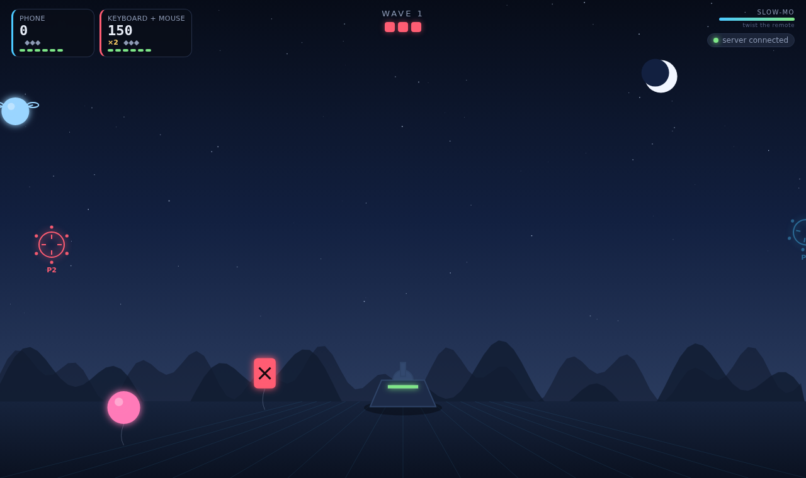
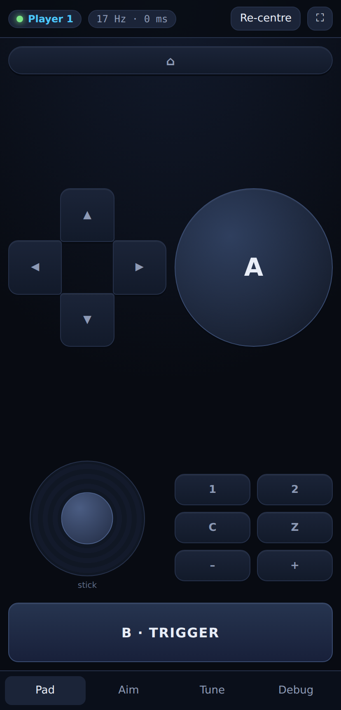
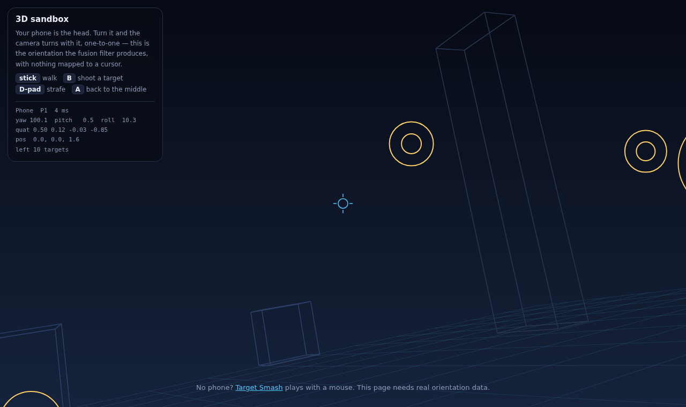

# phonemote

Your phone, as a Wii-style motion controller for your computer. Point it at the
screen and a cursor follows. Swing it, shake it, twist it, and the game knows.
No app to install, no account, nothing leaves your network — it is a small Node
server on your machine and two web pages.



- **Pointing that behaves like a Wii remote.** Aim at the screen, the cursor is
  where you point. Roll the phone and the cursor rotates but does not slide.
- **Gestures**: swing, shake, thrust and twist, each with a strength value.
- **Rumble** back to the phone through the vibration motor.
- **Four players** at once, each with a coloured cursor.
- **A test game** (Target Smash) and a **3D sandbox** where the phone is your head.
- **Optional air mouse**: `--mouse` drives the real desktop cursor.
- Works with a mouse and keyboard too, so you can try it before you get up.

## Quick start

```bash
git clone <this repo>
cd phonemote
npm install
npm start
```

The terminal prints a QR code and two addresses:

```
  1. On your phone (same WiFi):  https://192.168.1.24:8443/c?t=K7QMR
  2. On this computer:           https://localhost:8443/game
```

Scan the code, accept the certificate warning once, tap **Connect & enable
motion**, point at the middle of your screen and tap **Re-centre**. That is the
whole setup.

### About that certificate warning

Phones only hand out gyroscope and accelerometer readings to pages in a secure
context, which means HTTPS, even on a LAN. phonemote generates its own
certificate on first run (`certs/`, git-ignored) and serves everything over it.
Your browser cannot vouch for a certificate your own laptop just made, so it
warns you. Tap through it — *Advanced → proceed* on Chrome, *Show details →
visit this website* on Safari. You only have to do it once per phone.

## Controls

| On the phone | Does |
| --- | --- |
| point at the screen | move the cursor |
| **B · TRIGGER** | shoot |
| **A** | bomb |
| swing the phone | slash |
| shake the phone | reload |
| twist the phone | slow motion |
| **Re-centre** | make "straight ahead" wherever you are pointing now |
| stick, D-pad | move, in the sandbox |

Without a phone: move the mouse to aim, left click to shoot, right click to
bomb, `Space` to slash, `R` to reload, `T` for slow motion.



## How the tracking works

The interesting part is turning noisy phone sensors into a cursor that feels
attached to your hand. The pipeline lives in
[`public/controller/motion.js`](public/controller/motion.js):

1. **Read the sensors.** The Generic Sensor API (`Gyroscope`, `Accelerometer`)
   where it exists — Chrome on Android — and `devicemotion` events everywhere
   else, which is what Safari on iOS gives you. iOS also reports acceleration
   with the opposite sign, so the reading is checked against the browser's own
   orientation estimate and flipped if the two disagree.

2. **Fuse gyro and accelerometer.** The gyroscope is fast and detailed but drifts;
   gravity is absolute but only tells you which way is down, and only when you
   hold still. A Mahony complementary filter integrates the gyro and steers the
   result toward the measured gravity vector, so orientation is responsive *and*
   never tips over.

3. **Learn the gyro bias.** Every gyro reads a small non-zero rate when it is
   perfectly still, and integrating that is exactly why a pointer slides off on
   its own. When the phone is still (low rotation, gravity at 1g) the filter
   learns that offset and subtracts it. This is what keeps the cursor put.

4. **Filter the pointer.** A [One-Euro filter](https://gery.casiez.net/1euro/)
   smooths it. Its cutoff rises with speed, so a resting hand gets heavy
   smoothing and a fast flick stays sharp — the usual "smooth or responsive"
   trade-off, avoided.

5. **Map to the screen.** The direction the phone points is compared against
   where it pointed when you last re-centred, and the difference in yaw and
   pitch is scaled through the aim range, a dead zone and an expo curve. Roll is
   reported separately, so tilting the phone spins the cursor without moving it,
   like a Wii remote.

6. **Spot gestures** in the gravity-free acceleration: a single big burst is a
   swing (with a direction), several in a row is a shake, a burst along the
   pointing axis is a thrust, a fast roll is a twist.

State goes over one WebSocket at 60 Hz. Button presses and gestures are sent as
their own events rather than sampled, so a tap between two frames is never lost.
On a normal home network the whole path costs a few milliseconds.

## Tuning

The **Tune** tab on the phone changes the feel, and everything is remembered:

| Setting | What it does |
| --- | --- |
| Sensitivity | how far the cursor travels for a given wrist movement |
| Aim range | degrees of turn that span the screen — smaller is twitchier |
| Smoothing | filters hand shake; high values add a little lag |
| Dead zone | ignores tiny wobble around the centre |
| Aim curve | fine control near the centre, faster at the edges |
| Swing force | how hard you have to move before a swing counts |

The **Aim** tab picks how you hold it (like a TV remote, or flat like a gamepad)
and whether pointing is **absolute** (aim at the screen, like a Wii) or
**relative** (behaves like a mouse, can be re-centred anywhere).

## As a real mouse

```bash
npm start -- --mouse
```

Player 1's pointer drives the actual desktop cursor and the trigger clicks.
It shells out to whatever the platform already has — `xdotool` on Linux,
`cliclick` on macOS (`brew install cliclick`), PowerShell on Windows — so there
is nothing to compile. If the tool is missing you get one warning and the rest
of phonemote carries on.

## What about Bluetooth?

Short version: a phone browser cannot be a Bluetooth gamepad, because Web
Bluetooth only lets a page act as a *central* (the thing that connects to
devices), never as a *peripheral* (the thing that gets connected to). No web
page on any phone can advertise itself as an HID controller.

What does work is Bluetooth tethering: turn on your phone's Bluetooth PAN,
pair it with your computer, and you get an IP link over Bluetooth — the same
WebSocket then runs across it with no WiFi involved. Details and setup steps
per platform are in [docs/BLUETOOTH.md](docs/BLUETOOTH.md).

## Multiplayer

Up to four phones. Each gets a slot, a colour and its own cursor, score and
ammunition. Just scan the same code from each phone; slots are handed out in
order and freed when a phone disconnects.

## The test game

**Target Smash** — waves of balloons, drones and crawlers come at your base.
Point and shoot, swing to slash anything close, shake to reload, twist for slow
motion, and do not shoot the red barrels. Crawlers that reach the base cost you
one of three lives. Everything a motion controller can do is wired to something
you can feel: hits rumble, so do misses that cost you.

**3D sandbox** (`/sandbox`) is the other half of the demo: the phone's
orientation *is* the camera, one to one, which is the closest this gets to a
headset. Walk with the stick, shoot the rings with **B**.



## Project layout

```
server/
  index.js      HTTPS + WebSocket server, static files, QR code, CLI
  hub.js        who is connected, slot assignment, relaying frames
  certs.js      self-signed certificate covering localhost and every LAN address
  mouse.js      optional desktop cursor driver
shared/
  protocol.js   message types and the button bitfield, used by both sides
public/
  controller/   the phone: motion pipeline (motion.js) and the pad UI
  game/         Target Smash
  sandbox/      3D look-around demo
  lib/          maths and filters, the WebSocket link, the game-side pad model
tools/
  check.js            end-to-end test, no browser needed
  browser-check.js    drives the real pages with synthetic phone motion
  sim-controller.js   a fake phone, for developing the game without one
```

## Testing

```bash
npm test                      # server, protocol, pairing, relaying, slots
node tools/sim-controller.js  # a fake phone that waves the pointer around
node tools/browser-check.js   # real Chromium, synthetic sensors, screenshots
```

`browser-check.js` feeds the controller page fabricated `devicemotion` events
and asserts that the pointer actually moves, that a still phone does not drift,
and that shooting a target in the game scores. It needs Playwright
(`npm i -D playwright && npx playwright install chromium`).

## Options

```
npm start -- [options]

  --port <n>       HTTPS port (default 8443)
  --http <n>       plain HTTP port that redirects to HTTPS (default 8080, 0 disables)
  --host <addr>    interface to bind (default 0.0.0.0)
  --token <s>      pairing code to require (default: a fresh random one per run)
  --no-token       no pairing at all; anyone on the network can connect
  --mouse          drive the real desktop cursor from player 1
  --screen <WxH>   screen size for --mouse if it cannot be detected
```

The pairing code is only ever handed out to the machine running the server, so
another device on the network cannot read it and skip the pairing step.
Connections from localhost are trusted without it, which is why the game page
just works.

## Troubleshooting

| Symptom | Cause |
| --- | --- |
| "Motion sensors need HTTPS" | you opened `http://`. Use the `https://` address. |
| Phone cannot reach the address | it is on a different network, or the WiFi has client isolation on (common on guest networks). Bluetooth tethering also works, see docs. |
| Cursor drifts slowly | lay the phone down flat and tap **Calibrate gyro** in the Aim tab, then re-centre. |
| Cursor is jumpy | raise **Smoothing**, or lower **Sensitivity**, in the Tune tab. |
| Cursor lags | lower **Smoothing**. Also check the `ms` figure in the top bar: much over 30 ms means a busy network. |
| Aiming feels too fast | raise **Aim range** — it is the number of degrees that spans the screen. |
| Swings do not register | lower **Swing force**. Some phones report weaker acceleration than others. |
| Nothing happens on iOS | you must tap **Connect & enable motion**; iOS only releases the sensors from a real tap. |

## Requirements

Node 18 or newer. A phone with a gyroscope, which is nearly all of them since
about 2013. Chrome or Safari on the phone; anything modern on the computer.

## Licence

MIT.
